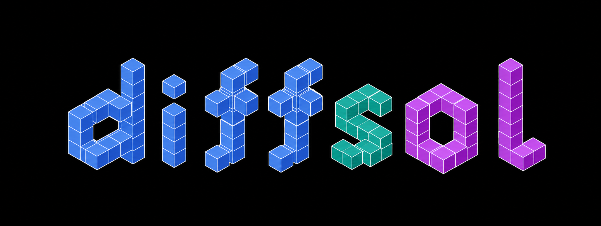

<p align="center">
  
</p>

Use [diffsol](https://github.com/martinjrobins/diffsol) solves as JAX
operations. Write the ODE equations as ordinary JAX functions and use the solves
in `jax.jit`, `jax.vmap`, `jax.grad`, `jax.jacfwd` and `jax.jacrev`.

The equations stay in JAX: every callback diffsol needs (`rhs`, its Jacobian
action, the adjoint, the sensitivities,...) is derived with JAX's own
transformations (`jax.jvp` / `jax.vjp`), lowered to StableHLO, and executed
natively through the PJRT C API. The solves run in diffsol
([diffsol-c](https://crates.io/crates/diffsol-c)) and are exposed to JAX as XLA
FFI custom calls. There is no translation of your Python to another language, so
anything JAX can trace works as an equation. See
[docs/architecture.md](docs/architecture.md) for the full design and benchmarks.

## Example usage

```python
import jax, jax.numpy as jnp
from diffsol_jax import ODEProblem, solve

jax.config.update("jax_enable_x64", True)

# one lane of the equations: x [nstates], p the parameters, t the time
problem = ODEProblem(lambda x, p, t: p[0] * x * (1.0 - x))
y0, p = jnp.array([0.1]), jnp.array([1.0])
t = jnp.linspace(0.0, 5.0, 11)
ys = solve(problem, y0, t, p)  # [nt, nstates]
ys = jax.vmap(solve, (None, None, None, 0))(problem, y0, t, jnp.ones((64, 1)))
g_y0, g_p = jax.grad(lambda y, p: solve(problem, y, t, p).sum(), (0, 1))(y0, p)
```

An `ODEProblem` is the equations and nothing else. Everything a solve needs
comes from the call: `solve(problem, y0, t_eval, args, solver=..., rtol=...,
atol=..., ad=...)`. The sizes are taken from the arguments — `nstates` from
`y0`, the parameters from `args`, `nout` from what `out` returns — and the
diffsol solver for those shapes is built on the first solve and reused by the
next (`problem.compile(y0, args, ...)` returns it, for its counters or to pay
the cost up front).

`solve` is differentiable in both `y0` and `args`. Reverse mode
(`ad="adjoint"`, the default) uses the diffsol adjoint with checkpointing;
forward mode (`ad="forward"`) uses diffsol forward sensitivities. A `jax.vmap`
over `y0` or over `args` becomes more lanes in a single batched solve, not a
loop of solves — so an ensemble over initial conditions costs one solve.

An initial state that is itself a function of the parameters is ordinary JAX
composition: `solve(problem, f(p), t, p)` differentiates through `f` without any
special case.

## Neural ODEs

`args` is any pytree, so the parameters can be a network: its float-array
leaves are the parameters, and every other leaf is captured by the equations as
a constant. `jax.grad` returns a pytree of the same structure, so optax updates
it directly:

```python
import equinox as eqx
from diffsol_jax import ODEProblem, solve

net = eqx.nn.MLP(4, 4, 64, 2, key=jax.random.key(0))  # any pytree of weights
problem = ODEProblem(lambda x, net, t: net(x))

def loss(net):
    ys = solve(problem, y0, t_eval, net, solver="tsit45")
    return jnp.sum((ys - data) ** 2)

grads = jax.grad(loss)(net)  # an MLP of gradients
net = optax.apply_updates(net, optimizer.update(grads, opt_state, net)[0])
```

To train the initial state with the weights, make it a leaf of the same pytree
and pass it as both: `solve(problem, v.y0, t_eval, v)`. Its gradient comes back
in `v`'s structure next to the weights. For full training loops, see
[examples/neural-ode-weather-prediction](examples/neural-ode-weather-prediction)
(the network alone) and
[examples/fitting-a-predator-prey-model](examples/fitting-a-predator-prey-model)
(the initial state and the rates together).

## DAEs

A singular mass matrix gives a semi-explicit index-1 DAE, solved with the
implicit solvers (`bdf`, the default, `esdirk34` or `tr_bdf2`) and
differentiable like any other problem. Write the algebraic equations as rows of
`rhs` and mark them with `algebraic=` (an int: the last states are algebraic; or
a boolean mask):

```python
# y' = -p0 * y   and   0 = z - p1 * y
problem = ODEProblem(
    rhs=lambda x, p, t: jnp.array([-p[0] * x[0], x[1] - p[1] * x[0]]),
    algebraic=1,
)
p = jnp.array([0.7, 2.0])
ys = solve(problem, jnp.array([1.0, p[1]]), t_eval, p)  # a consistent y0
```

The initial state is projected onto the algebraic constraints automatically
(diffsol solves the algebraic variables at `t0`), and the gradients account for
it — so the algebraic entries of the `y0` you pass are only a starting guess.
For a general (time-dependent) mass matrix, give `mass=lambda v, p, t: ...`, the
action `M(t) v`, which must be linear in `v` and must not use `p` (the diffsol
sensitivities have no `dM/dp` term, so a parameter-dependent mass would give a
wrong gradient and is rejected — fold such parameters into `rhs` instead).
Higher-index DAEs must be reduced to index 1 first.

## Building (development)

Requirements: Python ≥ 3.12, a Rust toolchain, cmake and a C++20 compiler, and a
CPU PJRT plugin.

1. Build diffsol-c from a [diffsol](https://github.com/martinjrobins/diffsol)
   checkout:

   ```sh
   cargo build -p diffsol-c --release
   ```

2. Set up the Python environment and build `libdiffsol_jax`:

   ```sh
   uv sync --group dev
   cmake -S . -B build -DCMAKE_BUILD_TYPE=Release \
     -DDIFFSOL_C_DIR=/path/to/diffsol/target/release \
     -DXLA_FFI_INCLUDE_DIR=$(.venv/bin/python -c "import jax.ffi; print(jax.ffi.include_dir())")
   cmake --build build
   ```

3. Get a CPU PJRT plugin. jaxlib does not ship one; a prebuilt plugin for
   linux/amd64 is inside [gopjrt](https://github.com/gomlx/gopjrt)'s
   `gomlx_xlabuilder_linux_amd64.tar.gz` release asset
   (`lib/gomlx/pjrt/pjrt_c_api_cpu_plugin.so`), or build
   `pjrt_c_api_cpu_plugin.so` from
   [openxla/xla](https://github.com/openxla/xla). Put it in
   `~/.local/share/pjrt/` (found automatically), or point
   `DIFFSOL_JAX_PJRT_PLUGIN` at it.

4. Make the package importable from the venv (once per venv):

   ```sh
   echo "$PWD/python" > "$(.venv/bin/python -c 'import site; print(site.getsitepackages()[0])')/diffsol_jax_dev.pth"
   ```

   After this, `uv run python` and `.venv/bin/python` import `diffsol_jax` from
   `python/`, with the native library from `build/` — no `sys.path` changes
   needed in scripts.

5. Run the tests:

   ```sh
   .venv/bin/python -m pytest tests
   ```

## Status

This branch is a rewrite onto the PJRT architecture (vendored from the diffsol
[`diffsol-jax2` example](https://github.com/martinjrobins/diffsol/tree/diffsol-jax2/examples/diffsol-jax),
see [issue #303](https://github.com/martinjrobins/diffsol/issues/303)). CPU and
`f64` only for now; GPU arrives with diffsol's GPU backend by loading the CUDA
PJRT plugin instead.
